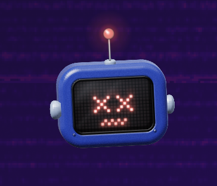
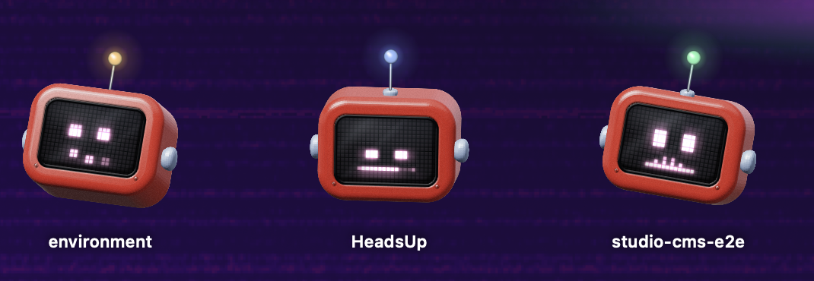
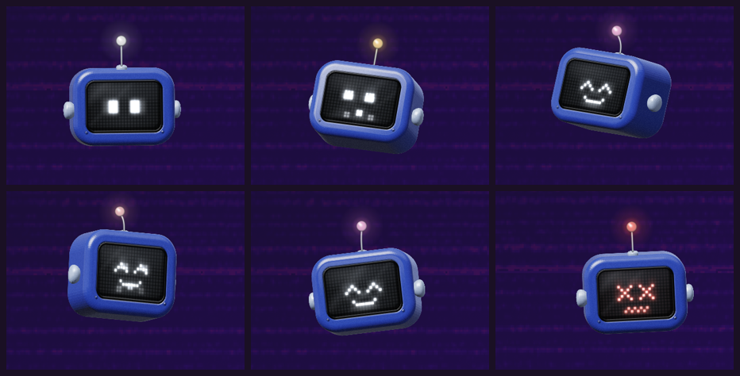
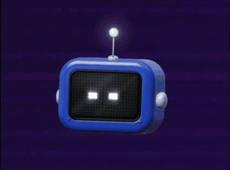
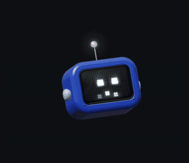
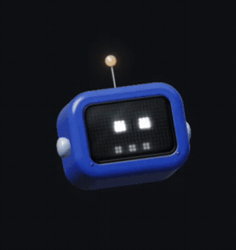
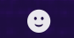
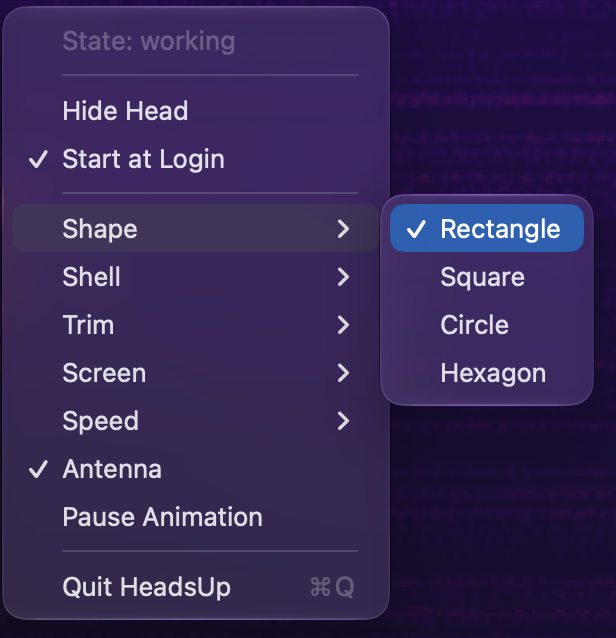
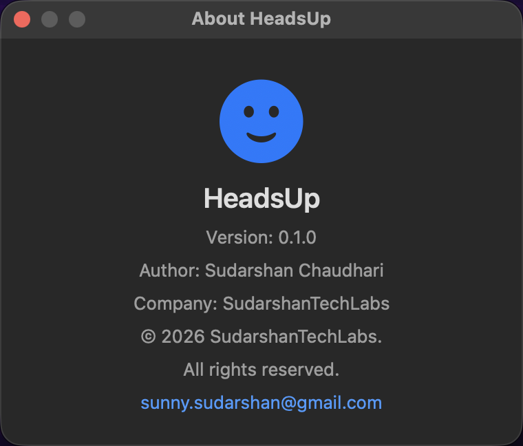
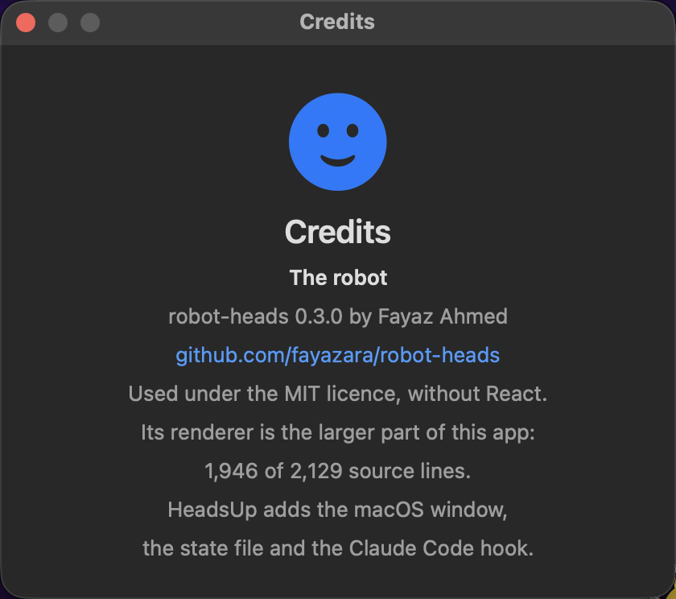

# HeadsUp

[](https://github.com/SUDARSHANCHAUDHARI/HeadsUp/releases/latest)     [](https://ko-fi.com/sudarshanchaudhari)

> A floating robot head on your Mac that shows what Claude Code is doing right now.

<div align="center">



</div>

HeadsUp is a small native macOS app. Claude Code hooks tell it what the agent is doing, and an animated robot head in a transparent always-on-top window shows it: thinking, searching, working, waiting for you, done, failed or asleep.

## Overview

When Claude Code runs in a terminal behind other windows, you cannot see at a glance whether it is still working, waiting for a permission, or finished. HeadsUp puts that status on screen as a small robot that sits above every app and every desktop space.

The robot is the drawing engine from [robot-heads](https://github.com/fayazara/robot-heads) by Fayaz Ahmed (MIT), used without React. HeadsUp adds the macOS window, the state file and the Claude Code hook.

## Features

- One head per live Claude Code session, fanned out side by side, each labelled with the folder it is working in
- Nine robot states, each with its own LED face, motion and antenna light
- Transparent, borderless window that floats above all apps and appears on every desktop space
- Drag the head anywhere; the position is remembered between launches
- Menu-bar icon showing the current state and how many sessions are running, with Hide Heads, Start at Login, About, Credits and Quit
- Pick the head's shape, shell, trim, screen colour and animation speed from the menu bar; the choice is remembered
- Right-click the head to quit; no Dock icon
- One hook script maps Claude Code events to states, always exits 0 and never blocks Claude
- One command installs that hook into `~/.claude/settings.json`, and takes it out again
- Shows `happy` when a turn ends, then returns to `idle` after 5 seconds
- Eyes and head follow the pointer when it is near
- With macOS Reduce Motion on, shows still poses instead of animating
- Optional start at login, from the menu bar or one command
- No React, no npm install: the web part is bundled with `bun build`

## Screenshots

<div align="center">



<em>One head per live Claude Code session, each labelled with the folder it is working in.</em>

<br><br>



<em>Six of the nine states — idle, thinking, happy and error among them.</em>

<br><br>


&nbsp;&nbsp;


<em>Left: the face, antenna light and pose change with every hook event.<br>
Right: eyes and head follow the pointer when it is near.</em>

<br><br>



<em>Four shapes, ten shells, five trims and five screen colours, picked from the menu bar.</em>

</div>

## Installation

### From source

```bash
git clone https://github.com/SUDARSHANCHAUDHARI/HeadsUp.git
cd HeadsUp
./build.sh
```

### Requirements

- macOS 13 or newer
- Xcode command line tools (Swift 5.9 or newer)
- [bun](https://bun.sh), used only to bundle the TypeScript

## Usage

```bash
# start the app (the head appears bottom-right the first time)
.build/out/Products/Release/HeadsUp

# show a state by hand (one file per session)
mkdir -p ~/.headsup/sessions && printf 'thinking\nDemo\n' > ~/.headsup/sessions/demo.state
```

If your Swift toolchain puts the binary elsewhere, `swift build -c release --show-bin-path` prints the folder.

## Configuration

```bash
./scripts/install-hooks.sh              # add the hook to ~/.claude/settings.json
./scripts/install-hooks.sh --status     # which events have it
./scripts/install-hooks.sh --uninstall  # take it out again
```

The script adds one hook group to eight events, using the absolute path to
this clone. It backs the file up to `settings.json.headsup.bak` before writing,
only writes when something changed, leaves your other settings and other hooks
alone, and refuses to touch a file it cannot parse. Running it twice is a
no-op. Re-run it if you move the repo.

To do it by hand instead, add this group to each of `UserPromptSubmit`,
`PreToolUse`, `PostToolUse`, `Notification`, `PermissionRequest`, `Stop`,
`StopFailure` and `SessionEnd`:

```json
{ "matcher": "*", "hooks": [ { "type": "command", "command": "bash /path/to/HeadsUp/hooks/headsup-state.sh" } ] }
```

Open sessions keep their old hooks; new sessions pick this up.

### Appearance

<div align="center">



<em>HeadsUp sits in the menu bar.</em>

<br><br>



</div>

The menu-bar icon holds every look option. Each takes effect at once and is
kept in `UserDefaults`, so it survives a relaunch.

| Menu | Choices |
|------|---------|
| Shape | Rectangle, Square, Circle, Hexagon |
| Shell | Cobalt, Tomato, Tangerine, Mustard, Mint, Teal, Grape, Bubblegum, Graphite, Porcelain |
| Trim | Steel, Silver, Brass, Copper, Black |
| Screen | White, Ice, Matrix, Amber, Neon |
| Speed | 0.5×, 1×, 1.5×, 2× |
| Antenna | on or off |
| Pause Animation | freezes the head on its current frame |

The swatches are robot-heads' own, so a preset here matches the same preset in
[its playground](https://robot-heads.fayaz.workers.dev/). A shape or antenna
change moves the head's bounds, and the window follows, keeping its top-left
corner where it was.

### About and Credits

<div align="center">


&nbsp;&nbsp;


<em>Left: version, author and contact. Right: what the robot is and whose it is.</em>

</div>

### Start at login

```bash
./scripts/login-item.sh install     # start HeadsUp now and at every login
./scripts/login-item.sh status      # plist, agent and process state
./scripts/login-item.sh uninstall   # stop starting at login
```

The menu bar's **Start at Login** item does the same thing. Either way it writes a per-user LaunchAgent to
`~/Library/LaunchAgents/com.sudarshantechlabs.headsup.plist` pointing at the
binary in this clone, so re-run `install` if you move the repo. Quitting the
head from its right-click menu does not relaunch it; the agent only runs it
at login.

## How It Works

```
Claude Code hook event (stdin JSON, carries session_id)
        │
        ▼
hooks/headsup-state.sh ──► ~/.headsup/sessions/<id>.state  (state + folder, written atomically)
                                   │
                                   ▼  the directory is scanned 4× a second
                      HeadsUp (one NSPanel + WKWebView per session)
                                   │
                                   ▼  window.setState(word)
                      robot-heads renderer on a <canvas>
```

Every live session gets its own head, with the name of the folder it is working
in underneath, so four robots on screen are four projects you can tell apart.
A new session's head appears beside the others; when a session ends, its head shows `sleeping` for 20 seconds and then
leaves, taking its file with it. A session that dies without a `SessionEnd` —
a crash, a kill, a reboot — is given an hour before its head is retired anyway.

The state file is two lines: the state, then the folder's name. A one-line file
is what the hook wrote before labels existed, and still works — that head simply
has no name under it.

The single `~/.headsup/state` file the hook wrote before sessions existed is
still read, but only when no session file exists, so an old hook keeps working
and a new one never shows a duplicate head.

| Hook event | State |
|---|---|
| `UserPromptSubmit`, `PostToolUse` | thinking |
| `PreToolUse` for Read, Grep, Glob, WebSearch, WebFetch | searching |
| `PreToolUse` for any other tool | working |
| `Notification`, `PermissionRequest` | listening |
| `Stop` | happy, then idle after 5 s |
| `StopFailure` | error |
| `SessionEnd` | sleeping |

No state file yet means no session has run, so the head sleeps. Unknown events leave the state unchanged. With several sessions open, the last event wins.

## Development

```bash
./build.sh                          # bundle web/src with bun, copy into the Swift target, swift build -c release
swift build                         # debug build of the app only (run ./build.sh once first)

# feed the hook a sample event
printf '{"hook_event_name":"PreToolUse","tool_name":"Grep"}' | bash hooks/headsup-state.sh
cat ~/.headsup/state                # searching
```

## Project Structure

```
HeadsUp/
├── VERSION                       # the one place the version number lives
├── Package.swift                 # Swift package, bundles Resources/web and VERSION
├── Sources/HeadsUp/
│   ├── main.swift                # the menu bar, and one head per session
│   ├── Head.swift                # one panel, one web view, one session's state
│   ├── Sessions.swift            # which sessions are live, and when a head retires
│   ├── Look.swift                # the saved appearance, and the JSON the page gets
│   ├── AboutWindow.swift         # the About and Credits panels
│   └── LoginItem.swift           # the LaunchAgent, shared by the CLI and the menu
├── web/
│   ├── index.html                # transparent page with one <canvas>
│   └── src/
│       ├── main.ts               # plain-DOM wrapper, exposes window.setState and setLook
│       ├── ticker.ts, color.ts, types.ts
│       └── tv/                   # robot-heads renderer (geometry, faces, light, sim, render)
├── hooks/headsup-state.sh        # Claude Code hook: event → per-session state file
├── scripts/
│   ├── install-hooks.sh          # add or remove the hook in settings.json
│   ├── package-release.sh        # HeadsUp.app + zip, signed when a cert exists
│   └── login-item.sh             # thin wrapper over HeadsUp --login-item
└── build.sh
```

`web/src/tv/*`, `ticker.ts`, `color.ts` and `types.ts` are copied unchanged from robot-heads 0.3.0.

## Releasing

`VERSION` is the only place the number lives. `build.sh` copies it into the app
bundle and the About panel reads it there, so a release is one file and one tag:

```bash
printf '0.2.0\n' > VERSION
./build.sh
```

Then commit the bump, tag `v0.2.0`, push the tag, and write the notes with
`gh release create`.

### Packaging a build

```bash
./scripts/package-release.sh      # dist/HeadsUp.app and dist/HeadsUp-<version>-macOS.zip
```

It wraps the executable in a real `.app` with an Info.plist, so the app can be
double-clicked and dragged to Applications instead of launched from a path.

Signing and notarisation are automatic when the machine has them: a
`Developer ID Application` certificate in the keychain signs the bundle, and a
`notarytool` profile named `HeadsUp` notarises and staples it. Store one with

```bash
xcrun notarytool store-credentials HeadsUp \
    --apple-id you@example.com --team-id TEAMID --password APP-SPECIFIC-PASSWORD
```

Without a certificate the script still produces a working `.app` and says so.
That build runs on the machine that built it, but Gatekeeper refuses it
anywhere else, which is why releases ship source for now.

Releases are listed at
[github.com/SUDARSHANCHAUDHARI/HeadsUp/releases](https://github.com/SUDARSHANCHAUDHARI/HeadsUp/releases).
They carry no binary: the app is unsigned and un-notarised, so building from
source is the only route that does not trip Gatekeeper.

## Roadmap / Status

Working: all nine states render, the hook drives one head per live Claude Code
session, and drag, quit and the menu-bar look options all work.

Not done: signing. `scripts/package-release.sh` builds a real `.app` and signs
and notarises it when the machine has a Developer ID, but no signed build has
been published, so releases ship source rather than a binary.

## Tech Stack

- **App**: Swift, AppKit (`NSPanel`), WebKit (`WKWebView`)
- **Robot**: TypeScript on a 2D canvas, bundled with bun
- **Integration**: Claude Code hooks, Bash

The transparent background uses WKWebView's undocumented `drawsBackground` key; a future macOS could change it.

## Credits

The robot itself is not my work. The drawing engine comes from
[robot-heads](https://github.com/fayazara/robot-heads) 0.3.0 by
[Fayaz Ahmed](https://github.com/fayazara), used under the MIT licence.

These files are copied from it unchanged, and are the larger part of this repo
(1,946 of its 2,129 source lines):

- `web/src/tv/geometry.ts`, `faces.ts`, `light.ts`, `sim.ts`, `render.ts`
- `web/src/ticker.ts`, `web/src/color.ts`, `web/src/types.ts`

The named swatches in the Shell, Trim and Screen menus are its playground's
too (`site/src/App.tsx`), so the presets match.

What HeadsUp adds is the macOS side: `Sources/HeadsUp/main.swift` (the
transparent always-on-top panel, the state-file polling and the menu bar),
`Sources/HeadsUp/Look.swift` (the saved appearance), `web/src/main.ts` (a
plain-DOM wrapper replacing the original React one) and
`hooks/headsup-state.sh` (the Claude Code hook). If you like the robot, star
the original repo.

## Support

HeadsUp is free and MIT licensed. If it saves you time, you can
[buy me a coffee](https://ko-fi.com/sudarshanchaudhari).

Questions and ideas belong in
[Discussions](https://github.com/SUDARSHANCHAUDHARI/HeadsUp/discussions);
bugs and concrete requests belong in
[Issues](https://github.com/SUDARSHANCHAUDHARI/HeadsUp/issues).

## License

MIT — see [LICENSE](LICENSE). Includes code from robot-heads, © 2026 Fayaz Ahmed, MIT.

---

## About

I'm Sudarshan Chaudhari, a Senior Quality Engineer, Test Automation specialist, and AI systems builder based in Bangkok, Thailand.

I have 13+ years of experience in software quality engineering, working across SaaS, fintech, gaming, web, mobile, cloud, and digital signage platforms. My background combines hands-on test automation with QA leadership, test strategy, CI/CD, release quality, production investigation, and cross-platform validation.

Alongside my professional QA career, I run [SudarshanTechLabs](https://sudarshantechlabs.com/), my independent engineering and product lab where I design, build, test, and ship software across Android, web, AI, cybersecurity, developer tooling, and cross-platform applications.

### What I work on

- ⚙️ **Quality Engineering & Test Automation** — Playwright, Selenium, Cypress, Appium, API testing, automation frameworks, end-to-end testing, CI/CD, release gates, GitHub Actions, risk-based testing, and production validation
- 🤖 **AI Systems & Automation** — AI agents, multi-agent orchestration, MCP servers, AI-assisted QA, prompt tooling, developer workflows, automation systems, and Claude Code plugins
- 📱 **Mobile & Cross-Platform Applications** — Android applications built with Kotlin and Jetpack Compose, Google Play releases, automated build and publishing pipelines, and cross-platform development spanning iOS, web, Windows, and macOS
- 🌐 **Web Applications & Platforms** — Full-stack applications using Next.js, TypeScript, Firebase, Cloudflare, REST APIs, and modern web infrastructure
- 🛠️ **Developer Tooling & CLI Engineering** — Rust, Python, TypeScript, CLI utilities, multi-repository tooling, build automation, release tooling, and engineering productivity systems
- 🛡️ **Cybersecurity & Observability** — Threat detection, log analysis, security auditing, vulnerability assessment, monitoring, and security-focused developer tools
- 📺 **Digital Signage & Device Platforms** — Content validation, playback testing, device compatibility, production investigation, monitoring, and QA across diverse hardware and operating-system environments

My work sits at the intersection of quality engineering, automation, AI, and software development. I approach products with a QA mindset from the beginning: understanding failure modes, designing for testability, automating repetitive work, and building release confidence into the engineering process.

Through SudarshanTechLabs, I also build products and tools from idea to production, covering architecture, development, testing, CI/CD, release automation, monitoring, and ongoing maintenance.

🌐 [sudarshantechlabs.com](https://sudarshantechlabs.com/) · 💼 [LinkedIn](https://linkedin.com/in/sudarshan-chaudhari) · 🐙 [GitHub](https://github.com/SUDARSHANCHAUDHARI) · ✉️ [sunny.sudarshan@gmail.com](mailto:sunny.sudarshan@gmail.com)
